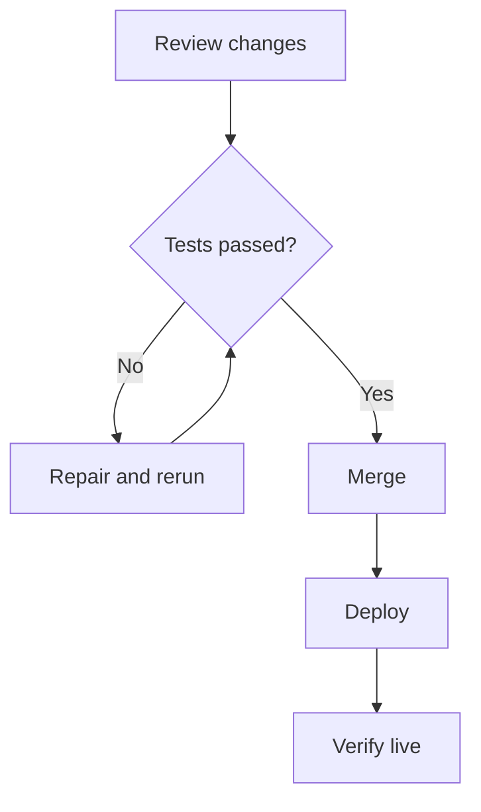

# Visual Authoring, Diagrams, and Dashboards

Use this topic when the user says **visual**, **visualize**, **visualization**, **visual post**, **visual article**, **visual report**, **diagram**, **dashboard**, **infographic**, **scorecard**, **status board**, **progress tracker**, **roadmap**, **timeline**, **flowchart**, **architecture map**, **comparison**, or **at a glance**. Also consider it for "show progress", "make this scannable", "draw the flow", or "show what remains." These are *intent keywords*, not names of a specific chat interface or visual product.

The goal is expressive, responsive **published Markdown** using Markata's existing building blocks. Do not assume the user wants a screenshot, generated image, app, or proprietary UI syntax. Select the output medium from the request. Use plain prose or a normal table when graphics would add no value.

## Choose the visualization that matches the information

| User intent | First choice in a Markata post |
| --- | --- |
| Status, release readiness, project health | `md-status`, `md-stat`, `md-progress`, a short evidence table |
| Numeric measurement with natural range | Native `md-meter` with explicit value and unit |
| Two or more options, before/after | `md-columns` with `md-card`, and semantic tables |
| Ranked tradeoffs or comparison | Markdown table with visible labels; sortable if supported |
| A time sequence, journey, change history | `::: road timeline`, `road steps`, or `road editorial` |
| Steps with branching decisions and edges | Fenced `mermaid` flowchart with adjacent prose |
| Simple infrastructure topology | `md-layout`, `md-box`, `md-columns`, `md-connector` |
| Arbitrary dependency/network graph | Mermaid; check the deployed Mermaid version first |
| Data trends or category shares | Fenced `chartjs` JSON with build-time accessible table fallback |
| Publishing/activity calendar | Fenced `contribution-graph` block |
| Short feature explanation with icons | `md-feature`, `md-feature-icon`, `md-feature-body`, pinned `:lucide-...:` icons |
| Teaching a composition | Rendered example plus `md-source` native details |

Read `topics/rich-markdown.md`, `topics/roads.md`, and `topics/analytics-storytelling.md` as needed. For exact syntax check `docs/guides/markdown-containers.md`, `markdown-metrics.md`, and `markdown-chart-fallback.md`. Inspect site overrides before adding new CSS.

## Compose an information-dense visual post

1. **Lead with the answer.** Explain what is done, what is risky, and what should happen next before decorating.
2. **Give a small overview.** Use two to four metric or status cards only when the labels and values are meaningful.
3. **Show relationships.** Prefer a progress list, before/after comparison, timeline, table, or diagram that answers a concrete question.
4. **Surface unresolved work.** Name the owner, blocker, verification state, next action, and evidence location. Never color "pending" green.
5. **End with action.** Finish a progress report with a prioritized next-step list and a handoff; include links to PRs, builds, or screenshots.
6. **Make evidence explicit.** Separate *implemented*, *locally tested*, *CI passed*, *merged*, *deployed*, and *verified live*. Merging does not prove deployment.

### Example: visually readable release status

The numbers below are illustrative author-supplied data, **not live Markata measurements**.

~~~~markdown
## Release progress

::: md-layout

:::: md-columns

::::: md-stat {data-tone="success"}
Checks passing

**8 / 10**

2 checks are pending

:::::

::::: md-stat {data-tone="caution"}
Production

**Not verified**

The deployment revision is unknown

:::::

::::

:::: md-progress {data-value="8" data-max="10" data-label="Eight of ten release checks passed"}

8 of 10 release checks passed.

::::

:::: md-status {data-tone="caution"}

Awaiting production smoke test.

::::

:::

| Gate | State | Evidence |
| --- | --- | --- |
| Local render | Passed | Screenshot |
| CI | Passed | Build link |
| Deploy revision | Unknown | Verify rollout |
| Live page | Pending | Browser audit |
~~~~

Choose `md-progress` for a bounded task process; choose `md-meter` for a real measurement. If no denominator or reliable number exists, use descriptive statuses instead of an invented percent. All gauges require numeric `data-value` and `data-max` and a descriptive `data-label`. Keep values and labels readable in ordinary Markdown.

### Example: a decision flow

~~~~markdown


The team merges only after tests pass; deployment and live verification
remain separate gates.
~~~~

Check the actual Mermaid runtime before authoring version-specific syntax. For example, `architecture-beta` requires a newer Mermaid runtime than 10.9.5. A compatible `flowchart` is preferable to a diagram that renders a syntax-error SVG. Test rendered output, not just a regex over Markdown.

### Example: numerical chart with text fallback

~~~~markdown
```chartjs
{
  "type": "bar",
  "data": {
    "labels": ["Build", "Review", "Deploy"],
    "datasets": [
      {"label": "Completed checks", "data": [5, 3, 0]}
    ]
  }
}
```
~~~~

Chart.js fenced blocks publish a semantic data-table fallback at build time. When JavaScript is unavailable or Chart.js fails, the reader still has the source values. Do not turn real-time dashboards into static claims without disclosing freshness.

## Design and accessibility

- Use a clear title, restrained card count, readable typography, and generous but economical spacing. Prefer one strong visual over decorative charts everywhere.
- Prefer theme tokens and built-in `md-*` layouts; do not hardcode light-only colors, install an icon font, or invent a heavy JavaScript UI.
- Nested `:::` containers use progressively longer opening and matching closing fences, with bare colon-only closing lines and blank lines before closers.
- Use semantic headings, HTML tables, labeled gauges, text equivalents for diagrams, visible status words, and focusable controls. Color and iconography alone cannot communicate state.
- Mobile layouts must stack or scroll intentionally at 320, 360, 412, 768, and 1440 pixels; test dark/light/custom palettes.
- Check with JavaScript disabled, reduced motion, keyboard access, print where relevant, and code-copy controls that do not obscure code. Record screenshots after final build.
- Any screenshot or visual regression baseline must identify viewport, theme, revision, environment, and date.

## Limits and verification

Markata renders rich, static-first articles; it does **not** automatically verify project progress, read CI, or produce proprietary native widgets from Markdown. Gather evidence before presenting values. Distinguish a rendered diagram from a working interactive interface, and a screenshot from executable test coverage.

Run a fast local build while editing, then the normal production-equivalent build before release. Test both HTML/DOM semantics and the final browser appearance. For source-sensitive visuals, keep an example fixture and a regression check. Confirm the deployed revision, purge/cache behavior, and live page before marking release complete.

To install updates from a newly built Markata binary, run `markata agent update` and `markata agent doctor`; editing the bundled skill source alone does not update local agent installations.
