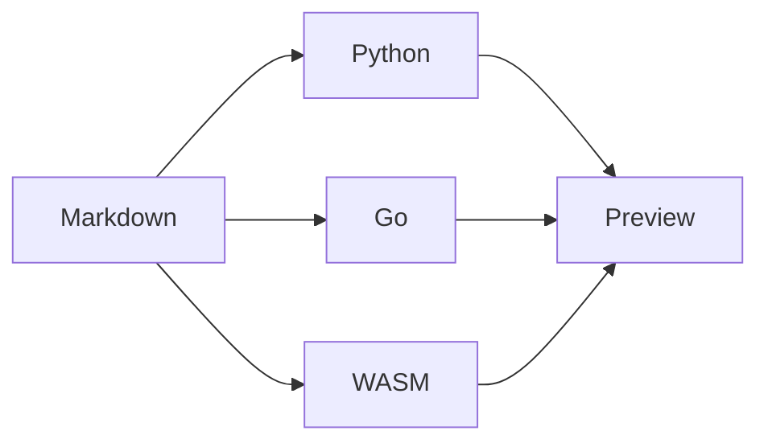

# From idea to published page

A tour of Markata's custom Markdown. Every element below can be inserted from **Commands** with **Ctrl/Cmd+P**.

::: md-columns

:::: md-card
::::: md-icon {data-size="lg"}
:lucide-route:

:::::

### Show the journey
Roads turn linked milestones into a path your readers can follow.

::::

:::: md-card
::::: md-icon {data-size="lg"}
:lucide-panels-top-left:

:::::

### Give ideas a home
Cards, columns, and feature rows create structure with ordinary Markdown.

::::

:::

## A publishing road

::: road steps

- [Shape the idea](#shape-the-idea) Start
- [Build the page](#build-the-page) Create
- [Review the result](#review-the-result) Finish

:::

## Shape the idea

::: md-feature

:::: md-feature-icon
:lucide-lightbulb:

::::

:::: md-feature-body
### Start with the reader's question

Use an icon feature row for one idea that deserves a clear explanation.

::::

:::

!!! tip "Try the command palette"
    Search **Article card**, **Road: steps**, or **Lucide: lightbulb**. The palette selects the editable part of each snippet.

## Build the page

The same source renders in Python, Go, and the offline WASM workbench.



::: md-columns

:::: md-stat {data-tone="success"}
Runtime choices

**3**

Python · Go · WASM

::::

:::: md-progress {data-value="2" data-max="3" data-label="Example review steps complete"}

Sample progress: 2 of 3 review steps complete.

::::

:::

## Review the result

This chart uses sample data to demonstrate the chart commands. These numbers are illustrative.

```chartjs
{
  "type": "bar",
  "data": {
    "labels": ["Draft", "Review", "Published"],
    "datasets": [{
      "label": "Example posts",
      "data": [3, 2, 5],
      "backgroundColor": ["#3b82f6", "#a78bfa", "#14b8a6"]
    }]
  },
  "options": {
    "plugins": {"legend": {"display": false}},
    "scales": {"y": {"beginAtZero": true, "ticks": {"precision": 0}}}
  }
}
```

| Example stage | Posts |
| --- | ---: |
| Draft | 3 |
| Review | 2 |
| Published | 5 |

::: md-checklist

- [ ] Read the copy
- [ ] Check the narrow layout
- [ ] Download a copy of the draft

:::

??? note "Small syntax, useful details"
    Mark ==important words==, show shortcuts such as ++Ctrl+P++, and write H~2~O or x^2^ without raw HTML.

::: md-source {data-label="See the card syntax"}

```markdown
::: md-card
### A clear title

A short explanation.

:::
```

:::

## Web Awesome and site features

These commands are also available in the palette. They insert site-authoring syntax. The standalone preview does not run the Web Awesome plugin or load its custom-element runtime.

For example, **Web Awesome: tabs** inserts:

```markdown
::: wa-tabs

:::: wa-tab {label="First"}

First panel content.

::::

:::: wa-tab {label="Second"}

Second panel content.

::::

:::
```

The palette includes comparison, details, tabs, copy button, QR code, badge, tag, tooltip, carousel, animated image, and raw Web Awesome component commands.

Wikilinks, post embeds, custom icon packs, hover cards, contribution graphs, and the table of contents also state their site requirements in the palette.
