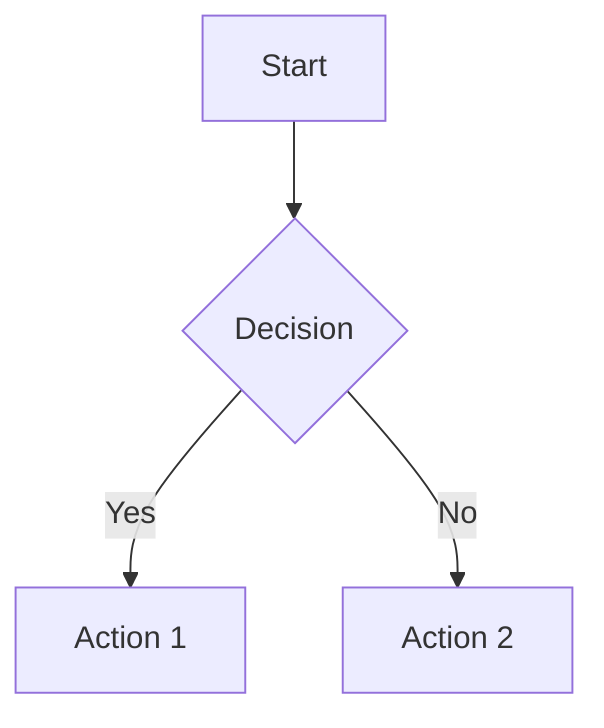

# Optional Plugins Specification

This document specifies optional plugins that extend the static site generator with additional features. Unlike default plugins, these must be explicitly enabled in the configuration.

## Plugin Overview

```
┌─────────────────────────────────────────────────────────────────────┐
│                       OPTIONAL PLUGIN SET                           │
├─────────────────────────────────────────────────────────────────────┤
│  CONTENT ENHANCEMENT                                                │
│    ├─ glossary            Auto-link terms to definition posts      │
│    ├─ mermaid             Render Mermaid diagrams                  │
│    ├─ chartjs             Render Chart.js charts                   │
│    ├─ webawesome          Render Web Awesome components             │
│    ├─ contribution_graph  GitHub-style calendar heatmaps           │
│    ├─ csv_fence           Convert CSV code blocks to tables        │
│    └─ md_video            Convert image syntax to video tags       │
│                                                                      │
│  LINK ENHANCEMENT                                                    │
│    ├─ one_line_link       Rich previews for URLs on own line       │
│    ├─ wikilink_hover      Hover previews for wikilinks             │
│    └─ external_link_hover Hover previews for external links        │
│                                                                      │
│  OUTPUT GENERATION                                                   │
│    ├─ image_optimization  Generate AVIF/WebP images               │
│    ├─ python_docs         Generate docs from Python source         │
│    └─ qrcode              Generate QR codes for posts              │
└─────────────────────────────────────────────────────────────────────┘
```

---

## Enabling Optional Plugins

Optional plugins must be explicitly enabled in your configuration. Add them to the `hooks` list:

```toml
[markata-go]
hooks = [
    "default",
    "glossary",
    "mermaid",
    "csv_fence",
]
```

Each plugin also has an `enabled` configuration option (default: `true`) that allows temporarily disabling a plugin without removing it from the hooks list:

```toml
[markata-go.mermaid]
enabled = false  # Disable mermaid without removing from hooks
```

---

## Content Enhancement Plugins

### `glossary`

**Stage:** `render` (late priority, after markdown conversion) + `write` (for JSON export)

**Purpose:** Automatically link glossary terms in post content to their definition pages.

**Dependencies:** None (uses standard library)

**Configuration:**

```toml
[markata-go.glossary]
enabled = true
link_class = "glossary-term"       # CSS class for glossary links
case_sensitive = false             # Match terms case-insensitively
tooltip = true                     # Add hover-card data (title + data-hover-title)
max_links_per_term = 1             # Link only first occurrence (0 = all)
exclude_tags = ["glossary"]        # Don't link in glossary posts themselves
export_json = true                 # Export glossary.json to output
glossary_path = "glossary"         # Path prefix for glossary posts
template_key = "glossary"          # templateKey value identifying glossary posts
```

**Configuration Fields:**

| Field | Type | Default | Description |
|-------|------|---------|-------------|
| `enabled` | bool | `true` | Whether the plugin is active |
| `link_class` | string | `"glossary-term"` | CSS class for glossary links |
| `case_sensitive` | bool | `false` | Whether term matching is case-sensitive |
| `tooltip` | bool | `true` | Add `title` (description) and `data-hover-title` (term name) for the hover card |
| `max_links_per_term` | int | `1` | Max links per term per post (0 = unlimited) |
| `exclude_tags` | []string | `["glossary"]` | Tags that should not have terms linked |
| `export_json` | bool | `true` | Whether to export glossary.json |
| `glossary_path` | string | `"glossary"` | Path prefix for glossary definition posts |
| `template_key` | string | `"glossary"` | templateKey frontmatter value identifying glossary posts |

**Post Frontmatter (Definition Posts):**

```yaml
---
title: API
templateKey: glossary
description: Application Programming Interface - a set of protocols...
aliases:
  - APIs
  - Application Programming Interface
---
```

**Behavior:**

1. Scan posts with `templateKey: glossary` or in configured glossary path
2. Build term → definition lookup including aliases
3. For each non-glossary post, find term occurrences in `article_html`
4. Replace with linked version: `<a href="/glossary/api/" class="glossary-term" title="...">API</a>`
5. At write stage: optionally export `glossary.json` with all terms

Matching keys MUST be ordered by descending length, then lexically for equal
lengths, after case normalization. When aliases share a link limit, this order
MUST choose the same occurrence on cold and cached builds regardless of map
iteration order. The matching-order revision MUST participate in the glossary
cache identity so pre-revision results are not restored.

**Protected Content:**

The plugin protects the following HTML elements from term linking:
- `<a>` tags (prevents double-linking)
- `<code>` tags (preserves code samples)
- `<pre>` tags (preserves preformatted content)

Nested protected elements MUST be restored outermost first. Internal protection
markers MUST NOT survive restoration, including anchors nested inside code or
preformatted blocks. Protection-order revisions MUST invalidate older cached
glossary results.

**Output Files:**

| File | Description |
|------|-------------|
| `{output}/glossary.json` | JSON export of all terms |

**Example glossary.json:**

```json
{
  "terms": [
    {
      "term": "API",
      "slug": "api",
      "description": "Application Programming Interface",
      "aliases": ["APIs"],
      "href": "/glossary/api/"
    }
  ]
}
```

**Interface requirements:**

The plugin MUST implement:
- `Plugin` - Basic plugin interface with `Name()` method
- `ConfigurePlugin` - To read configuration
- `RenderPlugin` - For term linking during the render stage
- `WritePlugin` - For JSON export during the write stage
- `PriorityPlugin` - To ensure late execution after markdown rendering

---

### `mermaid`

**Stage:** `render` (late priority, after markdown conversion)

**Purpose:** Convert Mermaid code blocks into rendered diagrams. Supports three rendering modes: client-side (browser), CLI-based (mmdc), or Chromium-based.

**Dependencies:**
- Client mode: None (uses CDN)
- CLI mode: `mmdc` binary from `@mermaid-js/mermaid-cli`
- Chromium mode: Chrome, Chromium, or compatible browser

**Configuration:**

```toml
[markata-go.mermaid]
enabled = true
mode = "client"                         # "client", "cli", or "chromium"
cdn_url = "/assets/vendor/mermaid/mermaid.min.js"  # vendored UMD bundle; .mjs URLs are ES-module imported
theme = "default"                       # default, dark, forest, neutral
use_css_variables = true                # Use site palette CSS variables for diagram theming
lightbox = true                         # Click diagrams to open in full-screen lightbox with pan/zoom
lightbox_selector = ".glightbox-mermaid" # CSS selector for mermaid lightbox links

# CLI mode configuration (when mode = "cli")
[markata-go.mermaid.cli]
mmdc_path = ""                          # Path to mmdc binary (auto-detect if empty)
extra_args = ""                         # Extra arguments to pass to mmdc

# Chromium mode configuration (when mode = "chromium")
[markata-go.mermaid.chromium]
browser_path = ""                       # Path to browser (auto-detect if empty)
timeout = 30                            # Timeout in seconds for rendering each diagram
max_concurrent = 4                      # Maximum concurrent diagram renderings
```

**Configuration Fields:**

| Field | Type | Default | Description |
|-------|------|---------|-------------|
| `enabled` | bool | `true` | Whether the plugin is active |
| `mode` | string | `"client"` | Rendering mode: `"client"` (browser), `"cli"` (mmdc), or `"chromium"` (Chrome DevTools Protocol) |
| `cdn_url` | string | `"/assets/vendor/mermaid/mermaid.min.js"` | URL for Mermaid.js library (client mode only). URLs ending in `.mjs`/containing `.esm.` are loaded with an ES module `import`; other URLs are loaded as a classic script and read from `window.mermaid`. |
| `theme` | string | `"default"` | Mermaid theme (default, dark, forest, neutral) |
| `use_css_variables` | bool | `true` | Derive diagram colors from site CSS custom properties (`--color-background`, `--color-text`, `--color-primary`, etc.) with hardcoded fallbacks. When enabled, the `theme` field is ignored. |
| `lightbox` | bool | `true` | Enable click-to-zoom lightbox overlay for rendered diagrams. Uses a programmatic GLightbox instance with svg-pan-zoom for interactive pan and zoom. |
| `lightbox_selector` | string | `".glightbox-mermaid"` | CSS selector for mermaid lightbox links (retained for backward compatibility; programmatic API does not use it). |
| `cli.mmdc_path` | string | `""` | Path to mmdc binary (CLI mode). If empty, searches PATH. |
| `cli.extra_args` | string | `""` | Extra command-line arguments for mmdc. |
| `chromium.browser_path` | string | `""` | Path to browser executable (Chromium mode). If empty, searches common installation paths. |
| `chromium.timeout` | int | `30` | Timeout in seconds for rendering each diagram. |
| `chromium.max_concurrent` | int | `4` | Maximum number of diagrams to render concurrently. |

When `use_css_variables` is enabled, Mermaid MUST use `--color-surface` for node
fills and edge-label backgrounds, `--color-text` for diagram text, and
`--color-border` (falling back to `--color-primary`) for borders and edges.
Cluster fills MUST use `--color-background`. Client mode MUST retain the source
of each diagram and rerender it on the site's `theme-change`, `palette-change`,
and `color-mode-change` events so an open page follows the active palette.
Chromium mode MUST use the same palette variables when it pre-renders SVGs. CLI
mode follows the Mermaid CLI theme and configuration because it does not use
the site's CSS variables.

**Rendering Modes:**

| Mode | Rendering | Best For | Dependencies |
|------|-----------|----------|--------------|
| `client` | Browser-side (Mermaid.js) | Simple diagrams, faster builds, no server resources | None (CDN) |
| `cli` | Build-time (mmdc binary) | Complex diagrams, static sites, SEO | `@mermaid-js/mermaid-cli` |
| `chromium` | Build-time (Chrome DevTools Protocol) | Complex diagrams, better performance than CLI, reuses browser instance | Chrome/Chromium |

**Installation Instructions by Mode:**

**Client mode:** No installation required. Uses Mermaid.js from CDN.

**CLI mode:** Install `@mermaid-js/mermaid-cli`:
```bash
npm install -g @mermaid-js/mermaid-cli
# or
sudo apt-get install mermaid-cli  # Debian/Ubuntu
brew install mermaid-cli           # macOS
```

**Chromium mode:** Ensure Chrome/Chromium is installed:
```bash
# macOS
brew install chromium

# Linux (Debian/Ubuntu)
sudo apt-get install chromium-browser

# Linux (Fedora)
sudo dnf install chromium

# Windows
# Download from https://www.chromium.org/getting-involved/download-chromium or use scoop/chocolatey
scoop install chromium
choco install chromium
```

**Syntax:**

````markdown

````

**Behavior:**

*Client mode:*
1. Find all `<pre><code class="language-mermaid">` blocks
2. Replace with `<pre class="mermaid">{diagram code}</pre>`
3. Inject Mermaid.js initialization script (once per post with mermaid content)
4. When `use_css_variables` is true, inject a script that reads CSS custom properties and passes them to `mermaid.initialize()`
5. When `lightbox` is true, attach click handlers to render SVG diagrams in a full-screen lightbox with pan/zoom

*CLI and Chromium modes:*
1. Find all `<pre><code class="language-mermaid">` blocks
2. Render each diagram to SVG at build time
3. Replace code blocks with embedded SVG HTML
4. If rendering fails (dependency missing), gracefully fall back to client-side rendering
5. When `lightbox` is true, attach click handlers to open SVGs in a full-screen lightbox with pan/zoom

**Output (client mode):**

```html
<pre class="mermaid">
graph TD
    A[Start] --> B{Decision}
    B -->|Yes| C[Action 1]
    B -->|No| D[Action 2]
</pre>

<script type="module">
  import mermaid from 'https://cdn.jsdelivr.net/npm/mermaid@10/dist/mermaid.esm.min.mjs';
  mermaid.initialize({ startOnLoad: true, theme: 'default' });
</script>
```

**Output (pre-rendering modes - CLI/Chromium):**

```html
<pre class="mermaid">
<svg viewBox="0 0 800 600" ...>
  <!-- Pre-rendered SVG content -->
</svg>
</pre>
```

**Lightbox interaction:**

| Action | Result |
|--------|--------|
| Click diagram | Open lightbox with full-size diagram |
| Mouse wheel / pinch | Zoom in/out |
| Click + drag | Pan the diagram |
| Fit button | Reset zoom to fit diagram in viewport |
| + / - buttons | Zoom in / out |
| Escape / click overlay | Close lightbox |

**CSS classes added (when lightbox enabled):**

| Class | Purpose |
|-------|---------|
| `.mermaid-lightbox-wrap` | Container inside lightbox (`position: relative; width: 100%; height: 90vh; overflow: hidden`) |
| `.mermaid-lightbox-toolbar` | Absolute-positioned toolbar (top-right, z-index 10) |
| `.mermaid-pz-btn` | Pan-zoom control buttons (Fit, +, -) |
| `.svg-pan-zoom_viewport` | Applied by svg-pan-zoom; `cursor: grab` / `cursor: grabbing` |

**Supported Diagram Types:**

| Type | Description |
|------|-------------|
| `graph` / `flowchart` | Flow diagrams |
| `sequenceDiagram` | Sequence diagrams |
| `classDiagram` | Class diagrams |
| `stateDiagram` | State diagrams |
| `erDiagram` | Entity relationship |
| `gantt` | Gantt charts |
| `pie` | Pie charts |
| `gitGraph` | Git graphs |
| `mindmap` | Mind maps |
| `timeline` | Timelines |

**Interface requirements:**

The plugin MUST implement:
- `Plugin` - Basic plugin interface with `Name()` method
- `ConfigurePlugin` - To read configuration
- `RenderPlugin` - To process posts during the render stage
- `PriorityPlugin` - To ensure late execution after markdown rendering

---

### `chartjs`

**Stage:** `render` (late priority, after markdown conversion)

**Purpose:** Convert Chart.js JSON blocks into rendered charts.

**Dependencies:** None (client-side rendering via CDN)

**Configuration:**

```toml
[markata-go.chartjs]
enabled = true
cdn_url = "https://cdn.jsdelivr.net/npm/chart.js"
container_class = "chartjs-container"
```

**Syntax:**

````markdown
```chartjs
{
  "type": "bar",
  "data": {
    "labels": ["Red", "Blue", "Yellow"],
    "datasets": [{
      "label": "Votes",
      "data": [12, 19, 3],
      "backgroundColor": ["#f87171", "#60a5fa", "#fbbf24"]
    }]
  }
}
```
````

**Behavior:**

1. Find all `<pre><code class="language-chartjs">` blocks
2. Parse JSON content
3. Replace with canvas element and initialization script
4. Inject Chart.js script (once per page)

**Output:**

```html
<div class="chartjs-container">
  <canvas id="chart-1"></canvas>
</div>

<script>
  new Chart(document.getElementById('chart-1'), {
    type: 'bar',
    data: { ... }
  });
</script>

<script src="https://cdn.jsdelivr.net/npm/chart.js"></script>
```

**Supported Chart Types:**

| Type | Description |
|------|-------------|
| `bar` | Bar chart |
| `line` | Line chart |
| `pie` | Pie chart |
| `doughnut` | Doughnut chart |
| `radar` | Radar chart |
| `polarArea` | Polar area chart |
| `bubble` | Bubble chart |
| `scatter` | Scatter plot |

**Interface requirements:**

The plugin MUST implement:
- `Plugin` - Basic plugin interface with `Name()` method
- `ConfigurePlugin` - To read configuration
- `RenderPlugin` - To process posts during the render stage
- `PriorityPlugin` - To ensure late execution after markdown rendering

---

### `contribution_graph`

**Stage:** `render` (late priority, after markdown conversion)

**Purpose:** Generate GitHub-style calendar heatmaps showing post activity using Cal-Heatmap.

**Dependencies:** None (client-side rendering via CDN)

**Configuration:**

```toml
[markata-go.contribution_graph]
enabled = true
cdn_url = "https://cdn.jsdelivr.net/npm/cal-heatmap@4"
container_class = "contribution-graph-container"
theme = "light"                    # light, dark
scale_max_percentile = 0            # 0 disables percentile-based outlier control
```

**Configuration Fields:**

| Field | Type | Default | Description |
|-------|------|---------|-------------|
| `enabled` | bool | `true` | Whether the plugin is active |
| `cdn_url` | string | `"https://cdn.jsdelivr.net/npm/cal-heatmap@4"` | URL for Cal-Heatmap library |
| `container_class` | string | `"contribution-graph-container"` | CSS class for container div |
| `theme` | string | `"light"` | Cal-Heatmap color theme |
| `scale_max_percentile` | number | `0` | Global percentile cap for color scaling. Set 1-100 to reduce outlier washout |

**Syntax:**

````markdown
```contribution-graph
{
  "data": [
    {"date": "2024-01-01", "value": 5},
    {"date": "2024-01-02", "value": 3},
    {"date": "2024-01-03", "value": 8}
  ],
  "options": {
    "domain": "year",
    "subDomain": "day",
    "cellSize": 12,
    "range": 1
  }
}
```
````

**Data Format:**

The `data` array should contain objects with:
- `date`: ISO date string (YYYY-MM-DD)
- `value`: Numeric value for that date (affects cell color intensity)

**Options:**

| Option | Type | Default | Description |
|--------|------|---------|-------------|
| `domain` | string | `"year"` | Time domain: "year", "month", "week", "day" |
| `subDomain` | string | `"day"` | Sub-domain: "day", "hour", "minute" |
| `cellSize` | number | `10` | Size of each cell in pixels |
| `range` | number | `1` | Number of domain units to display |
| `maxValue` | number | unset | Explicit color-scale maximum. Values above it use the max color |
| `maxPercentile` | number | unset | Per-graph percentile cap for the color scale |

**Behavior:**

1. Find all `<pre><code class="language-contribution-graph">` blocks
2. Parse JSON content (data and options)
3. Compute the graph color-scale maximum from the data. When `maxPercentile` or `scale_max_percentile` is set, use that percentile instead of the raw maximum.
4. Replace with div container and initialization script
5. Inject Cal-Heatmap CSS and JS (once per page), including built-in resize fitting so graphs fit narrow content columns without page-specific markdown scripts

**Output:**

```html
<div class="contribution-graph-container">
  <div id="contribution-graph-1"></div>
</div>

<link rel="stylesheet" href="https://cdn.jsdelivr.net/npm/cal-heatmap@4/cal-heatmap.css">
<script src="https://cdn.jsdelivr.net/npm/cal-heatmap@4/cal-heatmap.min.js"></script>
<script>
document.addEventListener('DOMContentLoaded', function() {
  const cal = new CalHeatmap();
  cal.paint({
    itemSelector: '#contribution-graph-1',
    data: {
      source: [{"date": "2024-01-01", "value": 5}, ...],
      x: 'date',
      y: 'value'
    },
    domain: { type: 'year' },
    subDomain: { type: 'day' }
  });
});
</script>
```

**Use Cases:**

- Blog post publishing frequency visualization
- GitHub-style contribution tracking
- Habit tracking displays
- Activity heatmaps for any date-based data

**Interface requirements:**

The plugin MUST implement:
- `Plugin` - Basic plugin interface with `Name()` method
- `ConfigurePlugin` - To read configuration
- `RenderPlugin` - To process posts during the render stage
- `PriorityPlugin` - To ensure late execution after markdown rendering

---

### `csv_fence`

**Stage:** `render` (late priority, after markdown conversion)

**Purpose:** Convert CSV code blocks into HTML tables.

**Dependencies:** None (uses standard library csv module)

**Configuration:**

```toml
[markata-go.csv_fence]
enabled = true
table_class = "csv-table"          # CSS class for table
has_header = true                  # First row is header
delimiter = ","                    # CSV delimiter
```

**Configuration Fields:**

| Field | Type | Default | Description |
|-------|------|---------|-------------|
| `enabled` | bool | `true` | Whether the plugin is active |
| `table_class` | string | `"csv-table"` | CSS class for generated table |
| `has_header` | bool | `true` | Whether first row is a header |
| `delimiter` | string | `","` | CSV field delimiter |

**Syntax:**

````markdown
```csv
Name,Age,City
Alice,30,New York
Bob,25,Los Angeles
Charlie,35,Chicago
```
````

**Behavior:**

1. Find all `<pre><code class="language-csv">` blocks
2. Parse CSV content
3. Generate HTML table with `<thead>` (if header) and `<tbody>`

**Output:**

```html
<table class="csv-table">
  <thead>
    <tr>
      <th>Name</th>
      <th>Age</th>
      <th>City</th>
    </tr>
  </thead>
  <tbody>
    <tr>
      <td>Alice</td>
      <td>30</td>
      <td>New York</td>
    </tr>
    <tr>
      <td>Bob</td>
      <td>25</td>
      <td>Los Angeles</td>
    </tr>
    <tr>
      <td>Charlie</td>
      <td>35</td>
      <td>Chicago</td>
    </tr>
  </tbody>
</table>
```

**Advanced Usage:**

Per-block options can override global configuration:

````markdown
```csv delimiter=";" has_header="false" table_class="custom-table"
1;2;3
4;5;6
```
````

**Interface requirements:**

The plugin MUST implement:
- `Plugin` - Basic plugin interface with `Name()` method
- `ConfigurePlugin` - To read configuration
- `RenderPlugin` - To process posts during the render stage
- `PriorityPlugin` - To ensure late execution after markdown rendering

---

### `python_docs`

**Stage:** `load`

**Purpose:** Discover Python source files, extract API docs from docstrings, and create source-backed documentation posts for docs sites.

**Dependencies:** Python 3 interpreter (`python3` or `python`) available on PATH.

**Configuration:**

```toml
[markata-go]
hooks = ["default", "python_docs"]

[markata-go.python_docs]
enabled = true
patterns = ["src/**/*.py", "pkg/**/*.py"]
exclude = ["**/tests/**", "**/.venv/**"]
use_gitignore = true
slug_prefix = "api"
template = "docs"
published = false
include_private = false
include_source = true
include_module_code = false
tags = ["python", "docs"]
interpreter = "python3"
```

**Configuration fields:**

| Field | Type | Default | Description |
|-------|------|---------|-------------|
| `enabled` | bool | `false` | Whether Python source docs are generated |
| `patterns` | []string | `["**/*.py"]` | Glob patterns used for discovery |
| `directories` | []string | `[]` | Convenience alias for directory roots (`dir/**/*.py`) |
| `exclude` | []string | common venv/cache globs | Glob patterns to skip |
| `use_gitignore` | bool | `true` | Respect `.gitignore` while scanning |
| `slug_prefix` | string | `"api"` | URL prefix for generated module pages |
| `template` | string | `""` | Template name for generated posts |
| `published` | bool | `false` | Publish generated docs in feeds/search/sitemap |
| `include_private` | bool | `false` | Include private `_symbols` |
| `include_source` | bool | `true` | Include implementation snippets under symbols |
| `include_module_code` | bool | `false` | Include module-level implementation source |
| `tags` | []string | `["python", "docs"]` | Tags applied to generated posts |
| `interpreter` | string | auto-detect | Python executable to use for AST extraction |

**Behavior:**

1. Scan configured Python files without replacing normal markdown content loading.
2. Parse each module with Python's AST.
3. Extract module, class, function, and method docstrings and signatures.
4. Slice implementation source away from leading docstrings so prose and code render separately.
5. Generate markdown posts with import lists and internal cross-links for discovered modules and symbols.
6. Only run when the plugin is explicitly listed in `[markata-go].hooks` and `enabled = true`.
7. Add generated posts to the normal lifecycle so existing templates, wikilinks, feeds, and HTML publishing still apply.

**Generated post fields:**

| Field | Description |
|-------|-------------|
| `title` | Python module name, e.g. `pkg.api.client` |
| `path` | Original source path, e.g. `pkg/api/client.py` |
| `slug` | Prefixed module path, e.g. `api/pkg/api/client` |
| `extra.python_docs` | Always `true` for generated docs posts |
| `extra.python_module` | Canonical module name |
| `extra.source_path` | Relative source file path |

**Generated markdown layout:**

- Module heading and source path
- Module docstring rendered as markdown
- Import section with internal links when targets are also documented
- API index for classes and functions
- Per-symbol sections with signatures, docstrings, and collapsible source snippets

**Cross-linking:**

- Backticked references like `` `pkg.util` `` are linked when they resolve to discovered modules.
- Sphinx-style refs such as `:func:`pkg.util.greet`` SHOULD link when the target symbol was discovered.
- Import lists SHOULD link both modules and known imported symbols.

**Interface requirements:**

The plugin MUST implement:
- `Plugin` - Basic plugin interface with `Name()` method
- `ConfigurePlugin` - To read configuration and resolve the interpreter
- `LoadPlugin` - To generate posts during the load stage

---

## Link Enhancement Plugins

### `one_line_link`

> **Note:** This plugin is planned but not yet implemented.

**Stage:** `render` (late priority, after markdown conversion)

**Purpose:** Expand URLs that appear alone on a line into rich preview cards.

**Dependencies:** None (optional: external HTTP client for metadata fetching)

**Configuration:**

```toml
[markata-go.one_line_link]
enabled = true
card_class = "link-card"
fetch_metadata = true              # Fetch title/description from URL
cache_metadata = true              # Cache fetched metadata
fallback_title = "Link"            # Title when fetch fails
timeout = 5                        # Fetch timeout in seconds

# URL patterns to exclude from expansion
exclude_patterns = [
    "^https://twitter.com",
    "^https://x.com",
]

# Custom templates per domain
[markata-go.one_line_link.templates]
"github.com" = "github-card.html"
"youtube.com" = "youtube-card.html"
```

**Syntax:**

```markdown
Check out this article:

https://example.com/awesome-article

And continue reading...
```

**Behavior:**

1. Find URLs that are alone on their own line (paragraph containing only a URL)
2. Fetch page metadata (title, description, image) if enabled
3. Replace with rich card HTML

**Output:**

```html
<p>Check out this article:</p>

<a href="https://example.com/awesome-article" class="link-card">
  <div class="link-card-image" style="background-image: url('...')"></div>
  <div class="link-card-content">
    <div class="link-card-title">Awesome Article Title</div>
    <div class="link-card-description">A brief description...</div>
    <div class="link-card-url">example.com</div>
  </div>
</a>

<p>And continue reading...</p>
```

**Detection Rules:**

| Pattern | Expanded? |
|---------|-----------|
| `https://example.com` (alone) | Yes |
| `Check out https://example.com` | No (inline) |
| `[Link](https://example.com)` | No (already link) |
| `<https://example.com>` | No (autolink) |

---

### `wikilink_hover`

**Stage:** `render` (late priority, after wikilinks plugin)

**Purpose:** Add hover previews to wikilinks showing target post content.

**Dependencies:** None

**Configuration:**

```toml
[markata-go.wikilink_hover]
enabled = true
preview_length = 200               # Characters to show in preview
include_image = true               # Include featured image if available
screenshot_service = ""            # URL of screenshot service (optional)
screenshot_width = 400
screenshot_height = 300
```

**Behavior:**

1. Find all wikilink anchors (`<a>` tags created by wikilinks plugin)
2. Add `data-preview` attribute with preview content
3. Optionally add screenshot URL

**Output:**

```html
<a href="/other-post/"
   class="wikilink"
   data-preview="Preview text from the target post..."
   data-preview-image="/other-post/featured.jpg">
  Other Post
</a>
```

**JavaScript Integration:**

The default theme's hover card component (`tooltips.js`, see
[LAYOUTS.md](LAYOUTS.md#hover-cards-default-theme)) displays the card. It uses
`data-preview` as the description when the wikilink has no `data-description`.

**Screenshot Service:**

If `screenshot_service` is configured:

```toml
screenshot_service = "https://screenshot.example.com/capture?url="
```

Output:

```html
<a href="/other-post/"
   data-preview-screenshot="https://screenshot.example.com/capture?url=https://mysite.com/other-post/">
  Other Post
</a>
```

---

### `external_link_hover`

**Stage:** `render` (`PriorityLate`, after `encryption`; registered after
`glossary` and before `templates` so the data reaches the rendered page)

**Purpose:** Add hover preview data to external links in post content so the
default theme's hover card can show where a link goes before the reader
clicks.

**Dependencies:** Reuses the `embeds` plugin's metadata cache and fetcher. No
other plugin has to be enabled.

**Configuration:**

```toml
[markata-go.external_link_hover]
enabled = false          # Opt in; adds data attributes to external links
fetch = false            # Fetch metadata for links with no cached data
include_image = true     # Add data-link-image when metadata has an image
favicon_service = ""     # e.g. "https://icons.duckduckgo.com/ip3/{host}.ico"
ignore_domains = []      # Hosts (and their subdomains) to skip
```

| Field | Type | Default | Description |
|-------|------|---------|-------------|
| `enabled` | bool | `false` | Whether the plugin annotates links |
| `fetch` | bool | `false` | Resolve uncached URLs with the `embeds` strategy (oEmbed/Open Graph) and cache the result. When `false`, the build makes no network requests |
| `include_image` | bool | `true` | Emit `data-link-image` |
| `favicon_service` | string | `""` | URL template for a site icon. `{host}` and `{origin}` are replaced. Empty means no icon |
| `ignore_domains` | []string | `[]` | Hosts to skip. A host matches itself and its subdomains |

**Link selection:** An `<a>` in `ArticleHTML` is annotated when all of these
hold:

- `href` is an absolute `http` or `https` URL whose host differs from the
  site `url` host and isn't in `ignore_domains`.
- It has none of the classes `wikilink`, `mention`, `glossary-term`,
  `heading-anchor`, or any class containing `embed-card` or `link-card`.
- It has no `data-link-preview`, `data-hover-card`, `data-hover-title`,
  `data-hover-description`, or `data-no-preview` attribute.

Posts with `skip`, `private`, or encrypted content are left alone, so the
build never fetches or exposes metadata for links in private posts.

**Metadata sources** (first non-empty value wins per field):

1. Cached `embeds` metadata for the URL (oEmbed, then Open Graph). With
   `fetch = true`, uncached URLs are resolved with the `embeds` resolution
   strategy and written to the same cache. Each URL is resolved at most once
   per build.
2. A `[[markata-go.blogroll.feeds]]` entry whose `site_url` (or `url`) host
   matches the link host: `title` becomes the site name, `description` the
   fallback description, and `image_url` the fallback image.
3. The link's own `title` attribute becomes the description.

A fallback title (such as the `embeds` "Link" placeholder) is ignored.

**Output:**

```html
<a href="https://go.dev/doc/"
   data-link-preview
   data-link-host="go.dev"
   data-link-title="Documentation - The Go Programming Language"
   data-link-description="The Go programming language..."
   data-link-site="Go"
   data-link-image="https://go.dev/images/go-logo-blue.svg"
   data-link-icon="https://icons.duckduckgo.com/ip3/go.dev.ico">Go docs</a>
```

`data-link-preview` and `data-link-host` are always present on annotated
links. All other attributes are omitted when empty. Values are HTML-escaped.

**Hover display:** The default theme's hover card component shows
`a[data-link-preview]` links as a card with the class `hover-card--external`:
an optional image, the title (falling back to the host), the description,
then the icon, site name (or host), and path. See
[LAYOUTS.md](LAYOUTS.md#hover-cards-default-theme).

---

## Output Generation Plugins

### `image_optimization`

**Stage:** `render` (late, after markdown conversion) + `write`

**Purpose:** Generate AVIF/WebP variants for local images and rewrite HTML to use `<picture>` with stable fallbacks.

**Dependencies:** Optional external encoders (`avifenc`, `cwebp`). Missing encoders should not fail builds.

**Configuration:**

```toml
[markata-go.image_optimization]
enabled = true
formats = ["avif", "webp"]
quality = 80
avif_quality = 80
webp_quality = 80
widths = [480, 768, 1200]
sizes = "100vw"
cache_dir = ".markata/image-cache"
avifenc_path = ""                 # Optional explicit path
cwebp_path = ""                   # Optional explicit path
```

**Configuration Fields:**

| Field | Type | Default | Description |
|-------|------|---------|-------------|
| `enabled` | bool | `true` | Whether the plugin is active |
| `formats` | []string | `["avif","webp"]` | Output formats to generate |
| `quality` | int | `80` | Default quality for all formats |
| `avif_quality` | int | `80` | AVIF quality override |
| `webp_quality` | int | `80` | WebP quality override |
| `widths` | []int | `[480,768,1200]` | Responsive widths to generate |
| `sizes` | string | `"100vw"` | Sizes attribute for responsive sources |
| `cache_dir` | string | `.markata/image-cache` | Cache directory for encode metadata |
| `avifenc_path` | string | `""` | Path to `avifenc` (auto-detect if empty) |
| `cwebp_path` | string | `""` | Path to `cwebp` (auto-detect if empty) |

**Behavior:**

1. Scan rendered HTML for `` tags with local `src` values.
2. Skip external URLs, protocol-relative URLs, and data URIs.
3. Rewrite each qualifying `` into a `<picture>` element with `source` tags, using `srcset` and `sizes` when widths are configured.
4. During write, generate requested formats and responsive width variants next to the original output image.
5. Use cache metadata to skip re-encoding unchanged inputs.
6. If an encoder is missing, warn and skip that format without failing the build.

**Output Files:**

```
output/
  images/
    sample.jpg
    sample-480w.avif
    sample-480w.webp
    sample-768w.avif
    sample-768w.webp
    sample-1200w.avif
    sample-1200w.webp
```

**HTML Output:**

```html
<picture>
  <source type="image/avif" srcset="/images/sample-480w.avif 480w, /images/sample-768w.avif 768w" sizes="100vw">
  <source type="image/webp" srcset="/images/sample-480w.webp 480w, /images/sample-768w.webp 768w" sizes="100vw">
  
</picture>
```

### `qrcode`

> **Note:** This plugin is planned but not yet implemented.

**Stage:** `write`

**Purpose:** Generate QR code images for each post's URL.

**Dependencies:** External QR code library (to be determined)

**Configuration:**

```toml
[markata-go.qrcode]
enabled = true
format = "svg"                     # "svg" or "png"
size = 200                         # Size in pixels
output_dir = "qrcodes"             # Subdirectory in output
filename_template = "{slug}.{format}"
error_correction = "M"             # L, M, Q, H
foreground = "#000000"
background = "#ffffff"
include_logo = false               # Embed site logo in center
logo_path = "static/logo.png"
```

**Behavior:**

1. For each post, generate QR code for its absolute URL
2. Save to output directory
3. Add `qrcode_url` field to post model

**Output Files:**

```
output/
  qrcodes/
    hello-world.svg
    another-post.svg
```

**Post Model Extension:**

Posts with QR codes will have the `qrcode_url` field set in their Extra map.

**Template Usage:**

```jinja2



```

---

## Plugin Dependencies

For the implemented plugins:

| Plugin | Required | Optional |
|--------|----------|----------|
| `glossary` | - | - |
| `mermaid` | - | - |
| `csv_fence` | - | - |

Planned plugins may have additional dependencies when implemented.

---

## Plugin Interaction

### Execution Order

When using multiple optional plugins, order matters:

```toml
hooks = [
    "default",           # Includes wikilinks
    "glossary",          # After render (needs article_html)
    "mermaid",           # After render
    "chartjs",           # After render
    "csv_fence",         # After render
    "md_video",          # After render
    "one_line_link",     # After render
    "wikilink_hover",    # After wikilinks (needs wikilink anchors)
    "qrcode",            # At save stage
]
```

### Conflicts

| Plugins | Issue | Resolution |
|---------|-------|------------|
| `glossary` + `wikilinks` | Terms in wikilinks get double-linked | Glossary excludes content inside `<a>` tags |
| `mermaid` + `csv_fence` | None | Process independently |
| `one_line_link` + any | URLs in code blocks | Exclude `<pre>` and `<code>` content |

---

## Disabling Optional Plugins

```toml
[markata-go]
hooks = ["default", "mermaid", "csv_fence"]
disabled_hooks = ["mermaid"]  # Disable mermaid specifically
```

Or set the `enabled` config option to false:

```toml
[markata-go.mermaid]
enabled = false
```

---

## Creating Custom Optional Plugins

Follow the pattern established by these plugins:

1. **Configuration**: Define config struct with sensible defaults
2. **Enabled Check**: Always check `config.Enabled` first
3. **Priority**: Use `lifecycle.PriorityLate` to run after markdown rendering
4. **Concurrent Processing**: Use `m.ProcessPostsConcurrently()` for post processing
5. **Error Handling**: Return errors, don't panic

Example plugin structure:

1. **Configuration**: Define config with sensible defaults
2. **Enabled Check**: Always check `config.enabled` first
3. **Priority**: Use late priority to run after markdown rendering
4. **Concurrent Processing**: Process posts concurrently when possible
5. **Error Handling**: Return errors, don't panic

**Plugin skeleton (pseudocode):**

```
class MyPluginConfig:
    enabled: bool = true
    option: string = "default"

class MyPlugin:
    config: MyPluginConfig

    function name() -> string:
        return "my_plugin"

    function priority(stage) -> int:
        if stage == STAGE_RENDER:
            return PRIORITY_LATE
        return PRIORITY_DEFAULT

    function configure(manager) -> error:
        # Read config from manager.config.extra["my_plugin"]
        return null

    function render(manager) -> error:
        if not config.enabled:
            return null

        return manager.process_posts_concurrently(post =>
            if post.skip or post.article_html == "":
                return null
            # Process post.article_html
            return null
        )
```

**Interface requirements:**

The plugin MUST implement:
- `Plugin` - Basic plugin interface with `Name()` method
- `ConfigurePlugin` - To read configuration
- `RenderPlugin` - To process posts during the render stage
- `PriorityPlugin` - To control execution order

---

## See Also

- [PLUGINS.md](./PLUGINS.md) - Plugin development guide
- [DEFAULT_PLUGINS.md](./DEFAULT_PLUGINS.md) - Default plugins
- [CONFIG.md](./CONFIG.md) - Plugin configuration
- [THEMES.md](./THEMES.md) - Styling for plugin output
